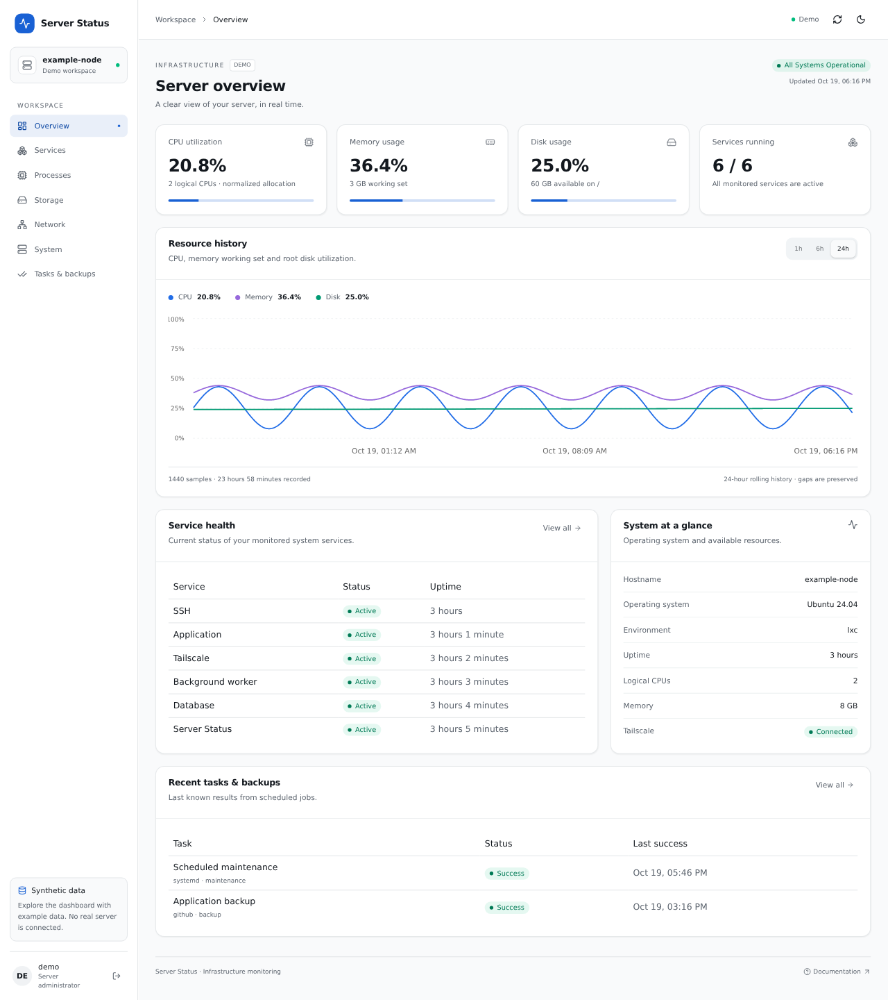

# Server Status

Server monitoring dashboard and REST API, distributed together as a standalone Go executable with an embedded React frontend.

See fake server-status on [fake-status](https://adam-zielonka.github.io/server-status/)



*The screenshot uses fictional demo data; no private server information is shown.*

## Build and run

Download the Linux amd64 or arm64 executable from the
[latest release](https://github.com/adam-zielonka/server-status/releases/latest),
or build from source below. Each release includes SHA-256 checksums.

Requires Go (see `api/go.mod`), Node.js 24–26 and pnpm 12 to build:

```bash
cd app && pnpm install --frozen-lockfile && cd ..
./build.sh
./build/server-status config check --config /path/to/config.json
./build/server-status serve --config /path/to/config.json
```

Open the configured HTTP address to use the dashboard. The executable serves both
`/` and `/api/*`; Node.js and pnpm are not needed at runtime. Configuration and
optional telemetry stay outside the executable. Use `serve --help` for listener
options and API-only mode, or `version` for build information. See the
[API guide](api/README.md) for configuration, cross-compilation, and reverse proxies.
The optional Linux collector is included as `collect` and runs separately through
systemd using the same executable. Python is not required; see the
[collector guide](collector/README.md) for optional system-tool integrations.

## Instruction

You can find more details by following these links:

- [REST API (Go)](api/README.md)
- [Web Application (React + TypeScript + Vite)](app/README.md), with shadcn/ui components.
- [Optional operations monitoring](collector/README.md): service health, top
  processes, container allocation, Tailscale status, resource history, directory
  growth, and scheduled tasks/backups. Host configuration and collected data
  stay outside the public repository; the demo uses synthetic examples.

## License
MIT
